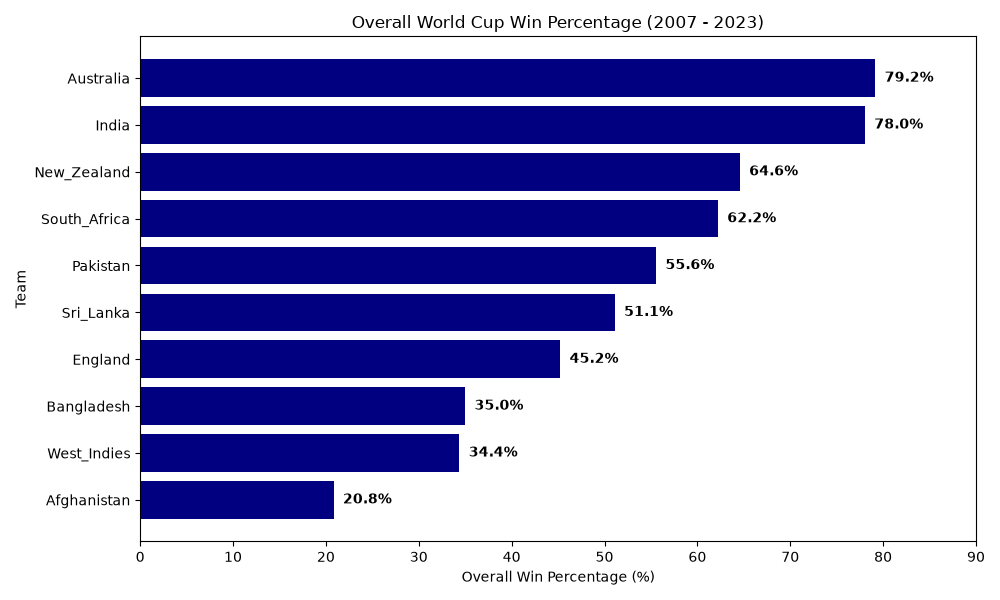
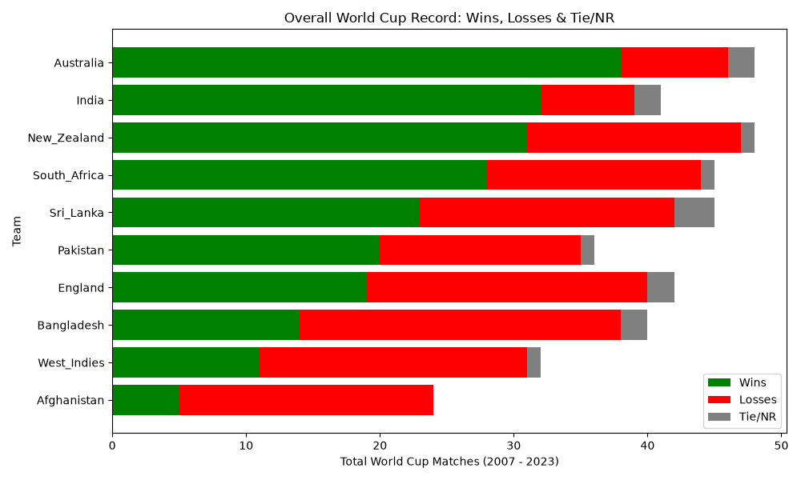
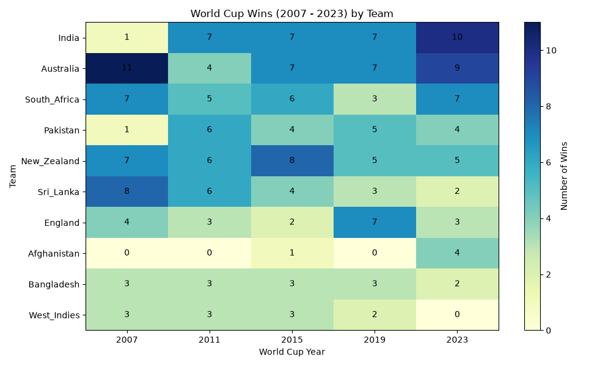
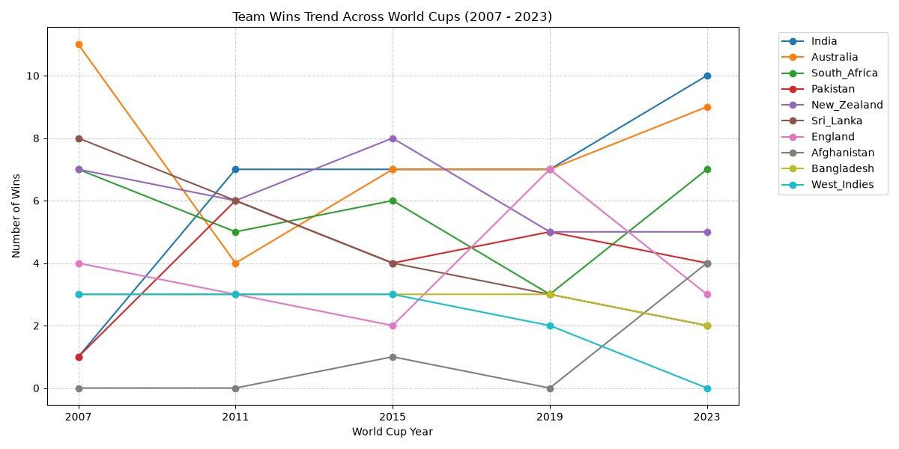
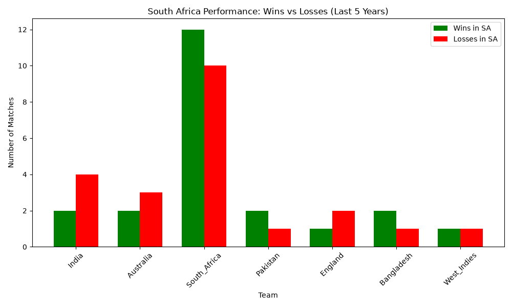
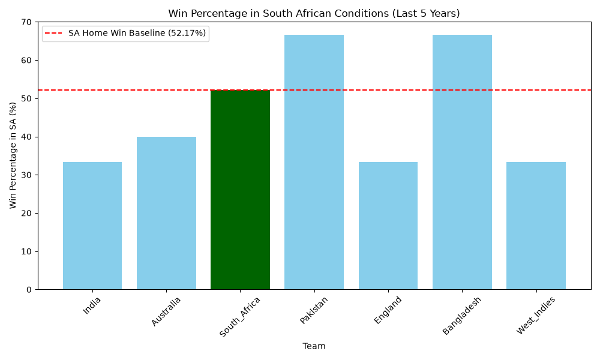
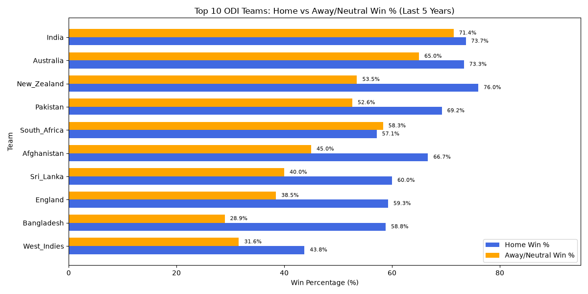

# 🏏 2027 ICC ODI World Cup Projection: Data Analysis

## 📌 Project Overview
This project analyzes the historical performance of the Top 10 ICC ODI teams to project their potential success in the upcoming 2027 ICC ODI World Cup hosted by South Africa. The analysis evaluates World Cup data from 2007 to 2023, recent South African tour records, and overall Home vs. Away performance metrics over the last 5 years.

## 🛠️ Technologies Used
* **Python** (Data Processing & Analysis)
* **Pandas** (Data Manipulation)
* **Matplotlib / Seaborn** (Data Visualization)

---

## 📊 Key Insights & Visualizations

### 1. Historical World Cup Performance Analysis (2007 – 2023)

* **Elite Leaders (Australia & India):** Australia leads the historical standings with a dominant 79.2% win rate. India follows closely behind in 2nd place with an impressive 78.0% win rate, establishing both nations as the premier, most consistent World Cup powerhouses.
* **Strong Contenders (New Zealand & South Africa):** New Zealand (64.6%) and South Africa (62.2%) maintain strong, reliable performance levels, consistently qualifying for knockout stages across multiple editions.
* **Moderate Performers (Pakistan & Sri Lanka):** Pakistan (55.6%) and Sri Lanka (51.1%) demonstrate competitive overall records, backed by strong historical tournament runs despite recent fluctuations.
* **Transition Tier (England):** Sitting at a 45.2% win rate, England shows a surprisingly modest overall World Cup record despite their 2019 title run.
* **Underperforming Nations:** Bangladesh (35.0%) and West Indies (34.4%) struggle with low conversion rates, while Afghanistan (20.8%) records the lowest win percentage due to early tournament campaigns.

### 2. World Cup Edition Performance Trends (2007 – 2023)

* **India (Strong Recovery & Dominant Peak):** After a disappointing early exit in 2007, India showed remarkable long-term consistency, reaching their operational peak in 2023 with 10 wins.
* **Australia (Sustained World-Class Benchmark):** Australia has consistently dominated nearly every edition, confirming their status as reigning World Champions.
* **New Zealand (Reliable Knockout Contenders):** Maintained a high-performance profile across all editions, peaking in 2015.
* **Sri Lanka (Post-Peak Downward Trajectory):** Enjoyed a golden era as back-to-back runners-up in 2007 and 2011, but has experienced a steady, continuous decline in recent tournaments.
* **Afghanistan (Rapid Emerging Force):** Progressed from non-participants to a breakthrough campaign in 2023 with 4 wins, highlighting their rise as a dangerous growing threat.

### 3. 2027 World Cup Host Conditions: SA Tour Records (Last 5 Years)

* **Host Advantage (South Africa):** Maintains a strong home foundation with a 52.17% baseline win rate, establishing positive historical momentum on home soil heading into 2027.
* **Emerging Threats (Pakistan & Bangladesh):** Both teams present the strongest challenge in South African conditions, recording the highest win rate among all visiting nations at 66.67%.
* **Struggles of Traditional Giants:** Top-ranked teams have suffered more losses than wins in South Africa recently. India (33.3%), Australia (40.0%), and England (33.3%) have all found the conditions challenging.

### 4. 2027 ICC ODI World Cup Projection: Home vs. Away Performance Analysis

* **India (High Semi-Final Probability):** Demonstrates exceptional form and mental resilience across all conditions, maintaining a near-identical win rate at home (73.7%) and away/neutral venues (71.4%). Based on this unmatched consistency, India holds the highest probability of qualifying for the Semi-Finals.
* **Australia (Proven All-Condition Performer):** Highly dominant at home (73.3%) while continuing to show strong adaptability in foreign conditions (65.0%), confirming their status as a major tournament contender anywhere in the world.
* **South Africa (Host Nation Advantage):** Maintains steady performance across all venues, surprisingly posting a slightly higher win rate away (58.3%) than at home (57.1%). As the 2027 World Cup hosts, their home-ground familiarity will be a critical factor.
* **New Zealand & Pakistan (Home-Dominant, Moderate Away):** Both teams leverage strong home-ground advantages (76.0% for NZ and 69.2% for PAK), but experience a noticeable drop to moderate performance levels (52%–53%) when playing overseas.
* **Afghanistan (Dangerous Dark Horse):** Although their stats show strong home capability (66.7%), their practical experience of playing almost exclusively at neutral venues (45.0%) makes them a genuine, unpredictable threat to top-ranked teams.
* **Sri Lanka & England (Overseas Vulnerability):** Both exhibit respectable home win rates (~60.0%), but suffer significant performance dips in away/neutral conditions (40.0% for SL and 38.5% for ENG), exposing a key weakness on foreign pitches.
* **Bangladesh (High Away Disparity):** Possesses solid home-ground strength (58.8%), but fails to translate it abroad, recording one of the lowest away win percentages (28.9%).
* **West Indies (Most Vulnerable Side):** Struggles consistently across both home (43.8%) and away (31.6%) venues, making them statistically the weakest team in the current Top 10 rankings.

---

## 🎯 Summary & Tactical Takeaway
While teams like **New Zealand**, **Pakistan**, and **Sri Lanka** rely heavily on home conditions, **India** and **Australia** remain the most complete sides capable of thriving in South Africa. **Afghanistan** stands out as the ultimate dark horse due to their extensive experience in neutral venues.